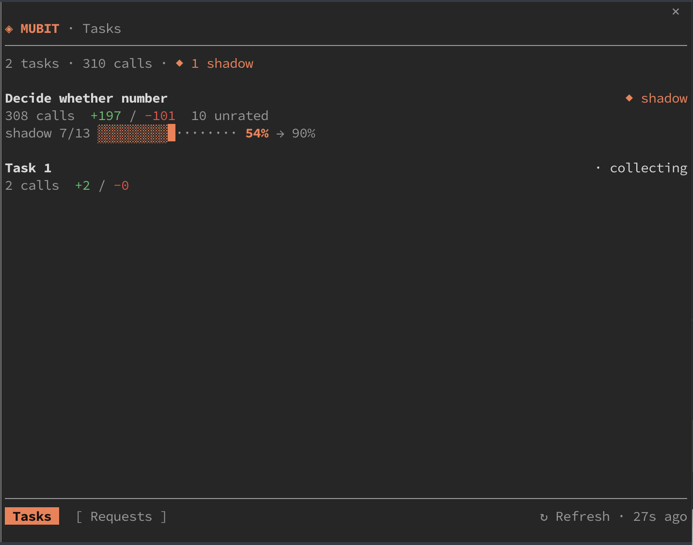

# mubit (Claude Code mod)

A pane beside the chat that shows your [Mubit](https://app.mubit.ai) at a glance:
tasks with their stage, call counts and a dotted shadow-promotion meter, and a
Requests view you can drill into to read a call and leave 👍/👎 feedback. It reads
live data through the `mubit` CLI and refreshes on a timer.



## Requires

The [`mubit` CLI](https://github.com/username255/mubit-cli) on your PATH, signed in
(`mubit login`). The mod runs it for every refresh. Set a different command or
project in the mod's config if needed.

## Install

```
/plugin install mubit --marketplace username255/mubit-mod
```

Then open the pane with `/mubit-ui` (it also opens on its own on a wide terminal).

## What it shows

- **Tasks** — a summary line (task/call counts, 24h calls · errors · p50), then one row
  per task: name, stage (`◆ shadow`, `● serving`, `· collecting`), calls, `+up / −down`
  ratings, and a dotted meter of the shadow pass rate against the bar it must clear
  (orange below, green once it clears), with pairs-to-go (`13/50 pairs`).
- **Requests** — calls, newest first, with who answered each (the adapter in orange, the
  provider dim; `◆` marks a silent-test reply), a dotted latency bar, status and rating.
  **Show all / traffic / shadow** picks which calls to list. **Older ›** and **‹ Newer**
  page through them; Older fetches the next page from Mubit when it runs out (needs a
  `mubit` CLI with `traces --with-cursor`; an older CLI shows one page). Click a row to
  open the call: its request and reply, any existing feedback, and 👍/👎 buttons with a
  note field to add your own.
- **Projects** — every project, the active one marked; click to switch which project the
  pane shows, or type a name and **Create** a new one. The active project appears in the
  header and scopes every view.

Loads are tolerant of a brief `503` from the engine (one retry, last-good data kept).

## Settings

| Option | Default | Meaning |
| --- | --- | --- |
| `command` | `mubit` | The CLI command (name on PATH or an absolute path) |
| `project` | (console's current) | Project slug to show |
| `refreshSeconds` | `60` | How often to refresh |
| `requestLimit` | `20` | How many recent calls the Requests view loads |

## Develop

```
git clone https://github.com/username255/mubit-mod.git
claude plugin validate mubit-mod
claude plugin test mubit-mod
```
